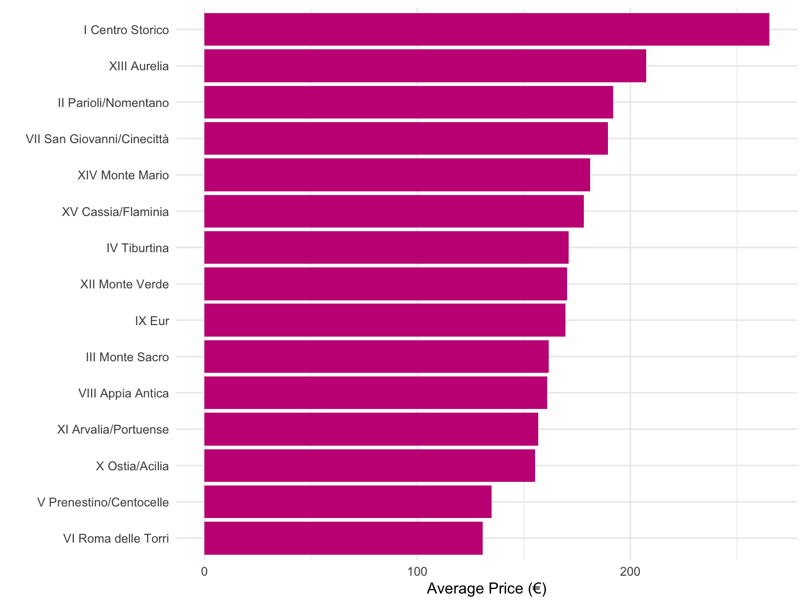
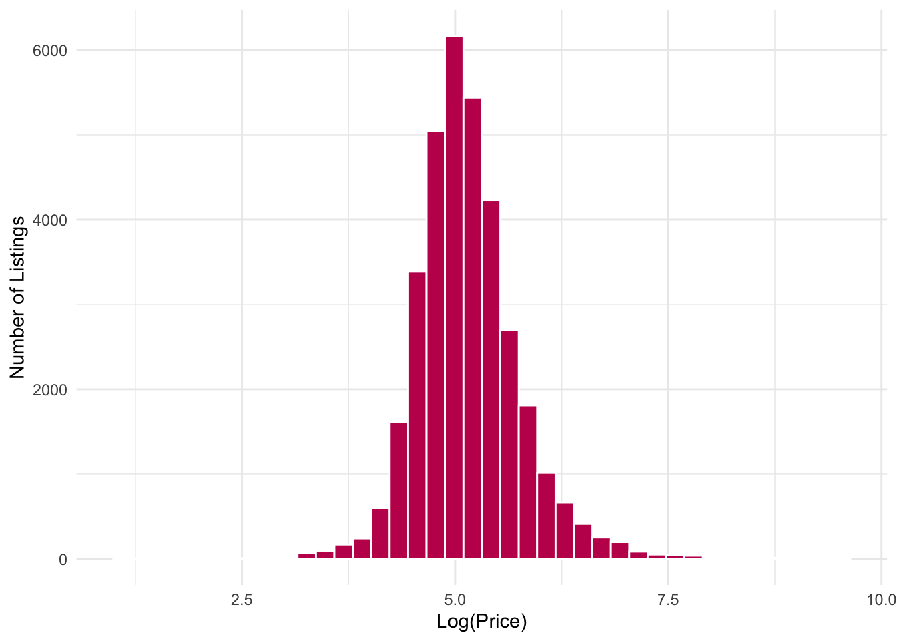
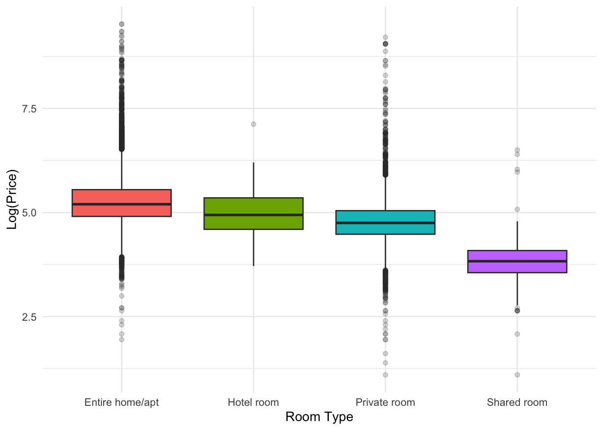
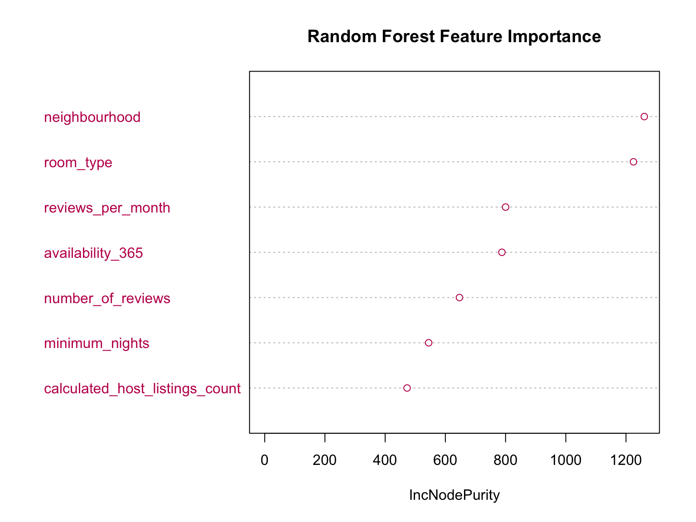
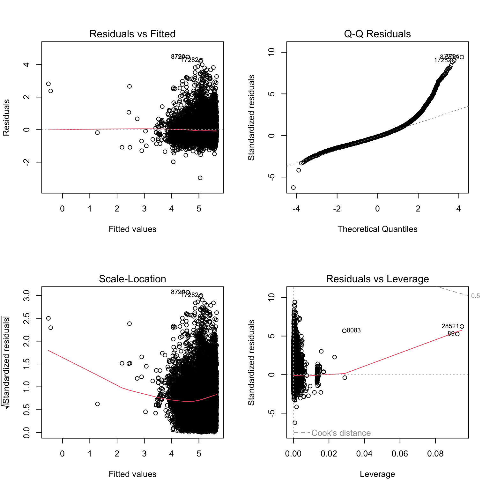

# Rome Airbnb Price Prediction

Data analysis project in R that explores Airbnb listing prices in Rome and compares a linear regression, a regression tree, and a random forest for predicting the nightly price.


# Project Overview

Setting a nightly price is a trade-off: too high and demand falls, too low and revenue is lost. This project uses the Inside Airbnb data for Rome to answer two questions:
        Which listing characteristics have the greatest influence on nightly prices?
        How accurately can statistical and machine learning models predict the price?


# Business Problem

For Airbnb hosts, setting the wrong nightly price can lead to:

* Lower occupancy rates
* Lost revenue
* Reduced competitiveness
* Poor booking performance

By understanding which variables drive pricing, hosts can make more informed pricing decisions while improving profitability.


# Dataset

Source: Inside Airbnb, Rome
Size: 37,228 listings, 19 columns.
Target: nightly price in euros, transformed with the natural log (log())
Predictors (7): room type, neighbourhood, minimum nights, number of reviews, reviews per month, availability (days per year), host listing count

## Project Workflow


Data Collection
        │
        ▼
Data Cleaning
        │
        ▼
Exploratory Data Analysis
        │
        ▼
Feature Engineering
        │
        ▼
Machine Learning
        │
        ▼
Model Evaluation
        │
        ▼
Final Report

Data inspection and cleaning (missing values, empty neighbourhood_group removed)
Exploratory data analysis (price distribution, room type, neighbourhood, correlations)
Log transformation of price
Linear regression (three specifications) for interpretation
Model comparison on a held-out test set: linear regression, regression tree, random forest
Interpretation and business recommendations

# Models and Evaluation
Several regression models were trained and compared.

Model	Purpose
Linear Regression	Baseline model
Regression Tree	Non-linear relationships
Random Forest	Ensemble learning

## Model Performance Comparison
The data were split at random into 80% training and 20% test (set.seed(123)); all models use the same split. No cross-validation or hyperparameter tuning was applied.

| Model | RMSE ↓ |
|:----------------------------|------:|
| Multiple Linear Regression  | 0.481 |
| Regression Tree             | 0.502 |
| **Random Forest(300 tress)**           | **0.465** |

**Random Forest achieved the lowest prediction error (RMSE = 0.465)**, outperforming both Multiple Linear Regression and Regression Tree. This suggests that ensemble methods better capture the nonlinear relationships present in Airbnb listing prices.

**Random Forest achieved the best predictive performance**, capturing the nonlinear relationships between listing characteristics and nightly prices while reducing prediction error compared with simpler regression models.

Models were evaluated using:
* R² Score


## Key Findings

* Neighbourhood and room type are the strongest drivers of price. In the random forest, neighbourhood ranks first and room type second. * Entire homes cost more than private or shared rooms, and the historic centre (I Centro Storico) has the highest average price.
* Prices are right-skewed. The log transformation makes the distribution much more symmetric.
* Numeric variables are weak individual predictors. Correlations with price are low. In the full OLS model, reviews per month and minimum nights are negatively associated with price, and the host's listing count is positively associated.
* The random forest predicts best, which suggests nonlinear relationships that the linear model misses. The gain over the baseline is modest.
* Residuals show mild heteroskedasticity and a heavy upper tail, driven by luxury listings

# Limitations
* Cross-sectional data from one snapshot; no seasonality
* No property size, amenities, photos, or listing text
* Single train/test split without cross-validation or tuning
* The linear models explain about one third of the variation in price (adjusted R² 0.354)

# Technologies Used
* Language: R, R Markdown
* Packages: tidyverse (dplyr, ggplot2), rpart, randomForest, knitr, kableExtra, stargazer


# Repository Structure
```text
rome-airbnb-price-prediction/
├── data/
│   ├── raw/
│   └── processed/
│
├── documentation/
│
├── presentation/
│
├── pricing.Rmd
├── pricing.html
├── README.md
├── LICENSE
└── .gitignore
```


# ## Exploratory Data Analysis

Before building machine learning models, exploratory data analysis (EDA) was performed to understand the structure of the dataset and identify key patterns influencing Airbnb prices.

### Average Price by Neighborhood



This visualization highlights substantial differences in average listing prices across Rome's neighborhoods, suggesting that location is one of the strongest determinants of Airbnb prices.

---

### Distribution of Log-Transformed Prices



The target variable was log-transformed to reduce right skewness and better satisfy the assumptions of regression models.

---

### Room Type vs Log Price



Entire homes command significantly higher prices than private or shared rooms, indicating that room type is an important predictor of listing price.

---

## Machine Learning Results

Several regression models were trained to predict Airbnb listing prices. Random Forest achieved the best predictive performance.

### Feature Importance



The Random Forest model identified accommodation size, location, and room characteristics as the most influential predictors of price.

---

### Residual Diagnostics



Residual diagnostics indicate that prediction errors are centered around zero with no major systematic patterns, suggesting the model provides a reasonable fit to the data.


## Skills Demonstrated
* Data cleaning and exploratory data analysis
* Linear regression and model diagnostics
* Regression tree and random forest, evaluated on a test set
* Data visualization with ggplot2
* Translating results into business recommendations


# Author
**Maria Murziankova**
Economics & Finance Student | Data Analytics | Business Intelligence

## Connect with Me
[](https://github.com/murziankovamaria-dotcom)

[](https://www.linkedin.com/in/maria-murziankova-004522327/)

[](https://public.tableau.com/app/profile/maria.murziankova/vizzes)
